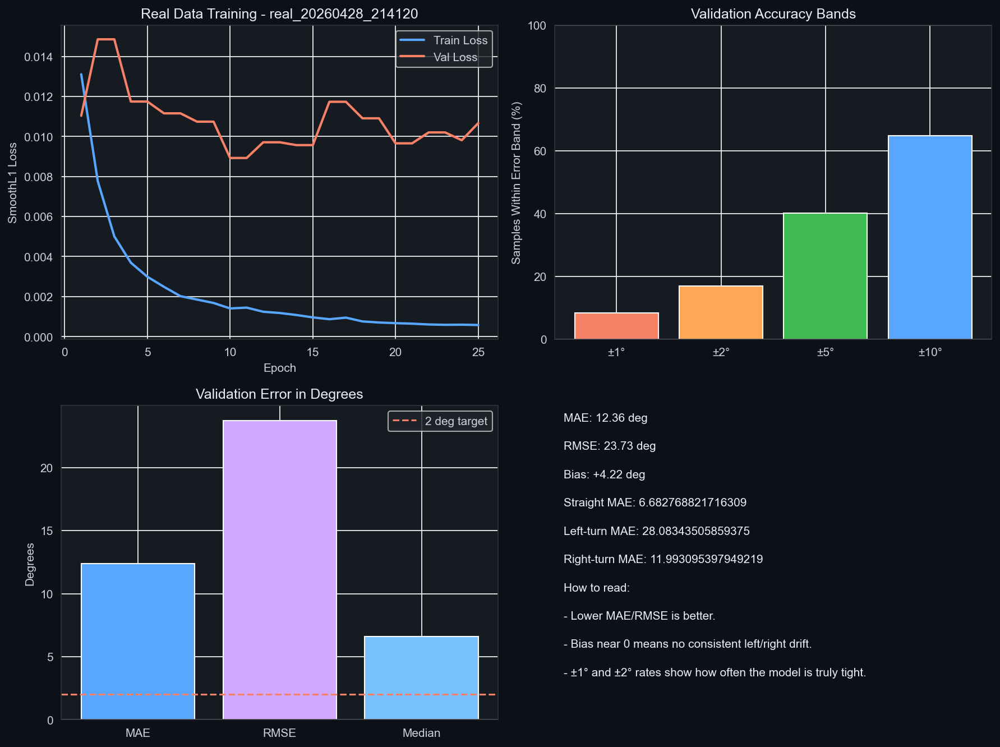

# Micro-AutoDrive

Micro-AutoDrive is a lightweight autonomous driving project designed to run on standard laptop hardware. It combines a procedural 2D simulation pipeline with a real-world steering prediction pipeline, making it useful for experimentation with behavioral cloning, temporal modeling, and model evaluation without depending on large simulator stacks or GPU-only infrastructure.

The raw dataset, checkpoints, cached data, and most generated outputs are not versioned. The repository includes one curated trained model and its validation summary and graph as a sample run, produced by this project using Sully Chen's dataset.

## Overview

The project is split into two main workflows:

- A synthetic driving pipeline built around a custom 2D environment, expert demonstration generation, and CNN-based imitation learning.
- A real-world steering pipeline built around dashcam frame preprocessing, class balancing, short temporal sequences, and a CNN+GRU architecture.

The overall aim is to provide a compact, understandable codebase for autonomous driving experiments that can be run and extended in a typical student or research environment.

## Repository Structure

```text
Micro-AutoDrive/
├── core/
│   └── model.py
├── v1_sim/
│   ├── analytics.py
│   ├── micro_env.py
│   ├── train.py
│   └── visualize.py
├── v2_real/
│   ├── data_loader.py
│   ├── train_real.py
│   └── visualize_real.py
├── CHANGELOG.md
├── README.md
└── requirements.txt
```

## Requirements

- Python 3.10 or newer
- Windows, macOS, or Linux
- 8 GB RAM minimum
- 16 GB RAM recommended for larger real-data preprocessing workflows

Install dependencies with:

```bash
pip install -r requirements.txt
```

## Running The Project

### Synthetic pipeline

```bash
python v1_sim/train.py
python v1_sim/analytics.py
python v1_sim/visualize.py
```

### Real-world pipeline

```bash
python v2_real/train_real.py
python v2_real/visualize_real.py
```

## Notes On Data

The repository does not include third-party datasets or locally generated training outputs. If you do not already have a dataset, you can use **Dataset 1** from [Sully Chen's driving-datasets repository](https://github.com/SullyChen/driving-datasets). It contains approximately 45,500 dashcam images with steering-angle labels and is hosted on [Google Drive](https://drive.google.com/file/d/1Ue4XohCOV5YXy57S_5tDfCVqzLr101M7/view?usp=sharing).

### Dataset attribution and use

Please credit **Sully Chen** as the creator and source of this dataset when using it. The original [dataset page](https://github.com/SullyChen/driving-datasets) describes it as intended for research and statistics only; do not use it to pilot or test a vehicle. Review the source repository's license and usage notes before redistributing the data.

After downloading and extracting the dataset, place its images and `data.txt` file in:

```text
Data/driving_dataset/
```

The real-world training and visualization scripts expect this folder and the `filename.jpg steering_angle` metadata format. The dataset is not included in this repository, so download and extract it yourself before running `v2_real/train_real.py` or `v2_real/visualize_real.py`.

### Published Sully Chen dataset run

The model and results below were produced by this project's CNN+GRU training pipeline using Sully Chen's Dataset 1. Dataset credit belongs to **Sully Chen**; these are Micro-AutoDrive's training outputs, not results published by the dataset creator.

| Artifact or validation metric | Value |
| --- | ---: |
| Model | [Download trained CNN+GRU weights](models/real_20260428_214120_final.pth) |
| Training run | 25 epochs; 28,817 training sequences |
| Validation sequences | 9,080 |
| Mean absolute steering error (MAE) | 12.36° |
| Root mean squared error (RMSE) | 23.73° |
| Median absolute error | 6.62° |
| Mean signed bias | +4.22° |

The [run summary](results/real_20260428_214120_summary.json) contains the full metrics and configuration. The validation data is a held-out portion of the same dataset, so these results do not establish performance on a separate drive or real vehicle.



This keeps the repository compact and avoids mixing source control with large machine-specific artifacts.

## Design Notes

- `core/` contains the shared model definitions.
- `v1_sim/` contains the simulation environment and synthetic training workflow.
- `v2_real/` contains the real-road data pipeline and temporal steering model workflow.
- Raw data, checkpoints, and temporary outputs are excluded from version control. `models/` and `results/` include the published sample model and its validation graph and summary.
