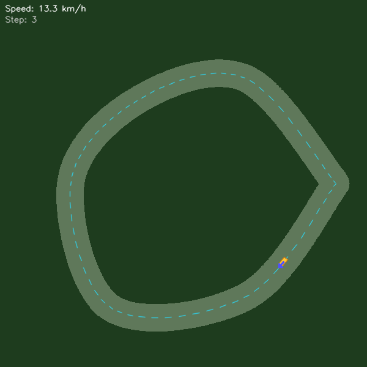

# Micro-AutoDrive

Micro-AutoDrive is a small behavioral-cloning project with two separate workflows: a procedural 2D driving simulator and an image-to-steering model trained on dashcam footage.

The real-data model predicts steering from recorded images. This repository does not contain a complete self-driving stack, a real-vehicle interface, or a safety system. Treat it as a learning and research prototype; do not use it to control or test a vehicle.

## See it run

The GIF shows the CNN policy driving in the project's toy 2D simulator. The human-driven expert trajectory is shown separately in the [trajectory plot](results/micro_20260428_171040_trajectory.png).



The repository also includes a sample dashcam model and its validation report. The raw Sully Chen dataset is not included.

## Project layout

```text
Micro-AutoDrive/
├── .github/workflows/ci.yml       # Python syntax check on pushes and pull requests
├── core/model.py                  # Shared CNN and CNN+GRU models
├── models/                        # Curated sample model weights
├── results/                       # Curated demo, graphs, and run summaries
├── v1_sim/                        # Procedural simulator and imitation learning
├── v2_real/                       # Dashcam data loader, training, and viewer
├── .gitignore
├── CHANGELOG.md
├── LICENSE
├── README.md
└── requirements.txt
```

Raw datasets, checkpoints, cached images, and temporary run outputs are ignored. Only the sample models and result files linked below are kept in Git.

## Requirements and setup

- Python 3.10 or newer
- 8 GB RAM for the simulator; 16 GB or more recommended for cached dashcam training
- CPU is supported; a CUDA-enabled PyTorch install can use a compatible GPU

Create and activate a virtual environment, then install the dependencies:

```bash
python -m venv .venv
```

Windows PowerShell:

```powershell
.\.venv\Scripts\Activate.ps1
python -m pip install -r requirements.txt
```

macOS or Linux:

```bash
source .venv/bin/activate
python -m pip install -r requirements.txt
```

## Run the synthetic simulator

Train the CNN policy, then launch the interactive viewer:

```bash
python v1_sim/train.py
python v1_sim/visualize.py
```

Training generates a model, synthetic demonstrations, and evaluation outputs locally. To build leaderboards and comparison charts from local run summaries, run:

```bash
python v1_sim/analytics.py
```

The checked-in GIF and summary are an example run; they are not a benchmark against real driving.

## Run the dashcam workflow

### Get the dataset

Download **Dataset 1** from [Sully Chen's driving-datasets repository](https://github.com/SullyChen/driving-datasets) using its [Google Drive download](https://drive.google.com/file/d/1Ue4XohCOV5YXy57S_5tDfCVqzLr101M7/view?usp=sharing). It contains approximately 45,500 dashcam images with steering-angle labels.

Extract the images and `data.txt` so the layout is:

```text
Data/driving_dataset/
├── data.txt
├── 0.jpg
├── 1.jpg
└── ...
```

The loader expects each metadata row to contain `filename.jpg steering_angle`. Credit **Sully Chen** as the dataset creator when using this data. The source describes the dataset as for research and statistics only; do not use it to pilot or test a vehicle. Follow the source page's terms if redistributing the dataset.

### Visualize or train

The supplied sample model can be used to visualize predictions after the dataset is installed:

```bash
python v2_real/visualize_real.py
```

To train a new model and create a new local run summary and graph:

```bash
python v2_real/train_real.py
```

Training caches preprocessed images in memory by default and may take substantial time on a CPU. New generated models and results are ignored by Git unless you explicitly curate them.

## Published sample results

### Synthetic simulator

The sample CNN completed five evaluation episodes without a simulated collision. These are metrics from the project's procedural environment, not real-road performance.

| Artifact or metric | Value |
| --- | ---: |
| [Sample model](models/micro_20260428_171040_final.pth) | CNN |
| [Run summary](results/micro_20260428_171040_summary.json) | 5 episodes |
| Mean episode reward | 4,156.76 |
| Mean episode length | 1,500 steps |
| Simulated collisions | 0 |

### Sully Chen dashcam dataset

This historical CNN+GRU run was trained by Micro-AutoDrive using Sully Chen's Dataset 1. The dataset credit belongs to **Sully Chen**; the model and results are this project's outputs.

| Artifact or validation metric | Value |
| --- | ---: |
| [Sample CNN+GRU weights](models/real_20260428_214120_final.pth) | Sequence length 5 |
| [Run summary](results/real_20260428_214120_summary.json) | 25 epochs |
| Training / validation sequences | 28,817 / 9,080 |
| Mean absolute error (MAE) | 12.36° |
| Root mean squared error (RMSE) | 23.73° |
| Median absolute error | 6.62° |
| Mean signed bias | +4.22° |
| Left-turn MAE | 28.08° |
| Validation samples within ±10° | 64.8% |


The reported labels use a three-frame steering average. Validation is a chronological holdout from the same recording, not a separate drive, so these numbers do not establish generalization to new roads. This published run predates the current sequence-gap and best-checkpoint fixes; retrain with the current code for updated results.

## Checks and license

GitHub Actions runs a Python syntax compilation check on pushes and pull requests. The project does not yet have a test suite.

The original Micro-AutoDrive code is licensed under the MIT License; see [LICENSE](LICENSE). This does not grant rights to Sully Chen's dataset or dataset-derived material. Follow the dataset creator's attribution and usage terms for those assets.
